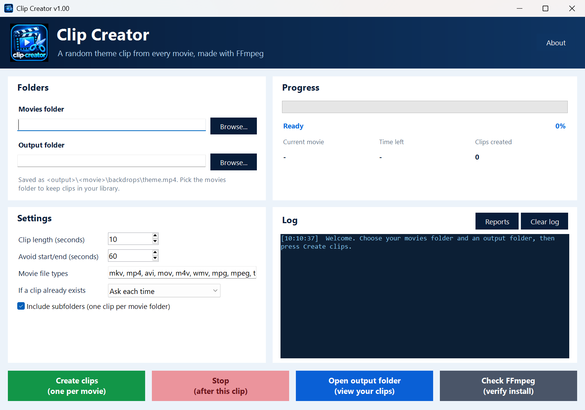

<p align="center">
  
</p>

# Clip Creator

A Windows app that makes one short random clip from every movie in a folder, ready to use as a Jellyfin, Emby or Kodi theme video.

    

## ✨ Features

Clip Creator is a front end for [FFmpeg](https://ffmpeg.org/). For each movie it picks a random point, away from the opening titles and end credits, cuts a short clip and saves it as `backdrops\theme.mp4` in a folder that matches the movie's own folder.

- **One clip per movie**: 10 seconds by default (1 to 600), starting at a random point
- **Avoids the start and end**: keeps clear of the first and last 60 seconds by default, when the movie is long enough
- **Keeps your folder layout**: `Mad Max (1979)\Mad Max.mkv` becomes `<output>\Mad Max (1979)\backdrops\theme.mp4`. Pick the movies folder itself as the output to save the clips straight into your library
- **Plays everywhere**: H.264 video and stereo AAC sound in an MP4, even from 10-bit HDR movies with 5.1 or 7.1 sound
- **Skips extras**: trailers, samples, `Extras`/`Featurettes` folders and existing `backdrops` folders are never treated as movies, so a second run never makes clips of clips. If a folder holds two videos (CD1/CD2 or two editions), the largest is used
- **Existing clips**: ask each time, always keep, or always replace
- **Safe to stop**: Stop finishes the current clip and stops; press it again to stop straight away. A clip is only saved once it's complete, so an existing `theme.mp4` is never lost to a failed or stopped run
- **Network friendly**: mapped drives and `\\NAS\share` paths work, and folders that can't be read are skipped rather than ending the run
- **Colour HTML report** after every run (and partial runs), with created, warnings, errors and skipped, and FFmpeg's own messages for anything that went wrong
- **Progress at a glance**: percentage, current movie, time left and clips created, with a colour log
- Remembers your folders and settings between runs

## 🖼️ Screenshots



## 📋 Requirements

- Windows 10 or 11 with Windows PowerShell 5.1 (built in, nothing to install)
- [FFmpeg](https://ffmpeg.org/) with `ffmpeg.exe` and `ffprobe.exe`. The easiest way is `winget install Gyan.FFmpeg`, which adds both to `PATH`. You can also put the two files in the same folder as Clip Creator. The **Check FFmpeg** button says whether they were found

## 📦 Installation

**Exe:** download `Clip Creator v1.00.exe` from the [latest release](../../releases/latest) and run it. Nothing else to install apart from FFmpeg.

**Script:** clone or download the repo, then double-click **`Start Clip Creator.cmd`**. It starts Clip Creator with an execution-policy bypass for that run only; no Windows settings are changed. If you downloaded a zip and Windows blocks the files, right-click the zip, choose **Properties**, tick **Unblock**, then unzip it again.

### Build the exe

Builds use the standard build script, which reads `build.json`, runs PSScriptAnalyzer, compiles the exe with [ps2exe](https://github.com/MScholtes/PS2EXE) and saves it to the project's `Builds\` folder (outside the repo) as `Clip Creator v<version>.exe`:

```powershell
E:\Created\_shared\Build-Tool.ps1 -Project "E:\Created\Home\Clip-Creator"
```

Until the shared build script is in place, double-click `Build-Exe.cmd` in the repo folder instead. It does the same build in Windows PowerShell 5.1 (no admin rights needed): it checks the script for syntax errors, installs ps2exe for your user the first time, and saves its output to `Build-Exe.log`. The version comes from `$AppVersion` at the top of `src\Clip-Creator.ps1`, which matches the newest CHANGELOG entry.

Some antivirus programs are wary of new ps2exe-built programs. If yours blocks the exe, allow it or keep using `Start Clip Creator.cmd`.

## 🚀 Usage

1. Choose your **Movies folder**, for example `V:\Movies` or `\\NAS\Movies`.
2. Choose an **Output folder**. Use a separate folder to check the clips first, or the movies folder itself to save them straight into your library.
3. Set the clip length and how much of the start and end to avoid, and whether to include subfolders.
4. Press **Create clips**.

When the run finishes, Clip Creator offers to open the report and the output folder.

### Where the clips go

```
Movies folder                          Output folder
V:\Movies\Mad Max (1979)\Mad Max.mkv   ->  D:\Clips\Mad Max (1979)\backdrops\theme.mp4
V:\Movies\Sci-Fi\Alien (1979)\Alien.mkv ->  D:\Clips\Sci-Fi\Alien (1979)\backdrops\theme.mp4
V:\Movies\Loose Movie.mp4              ->  D:\Clips\Loose Movie\backdrops\theme.mp4
```

A movie sitting directly in the movies folder (not in a folder of its own) gets a folder named after the file. With **Include subfolders** off, only those loose files are used.

### Stopping

Press **Stop** once to stop after the clip that's being made. Press it again to stop straight away; the half-made clip is thrown away. Closing the window while clips are being made asks first. Either way, a partial report lists everything handled so far.

### Troubleshooting

- **"FFmpeg or FFprobe wasn't found"**: run `winget install Gyan.FFmpeg`, then restart Clip Creator (a new `PATH` only reaches programs started afterwards).
- **A mapped drive is missing from Browse**: drives mapped as your normal user don't show up in programs run as administrator. Start Clip Creator normally; it doesn't need admin rights. Typing or pasting a `\\NAS\share` path always works.
- **A movie is marked ERROR**: the report shows FFmpeg's message. Damaged files and some old formats can't be read; the run carries on with the next movie.
- **The time left jumps about**: it's based on the movies done so far, so it settles as the run goes on.
- **"Running scripts is disabled"**: start it with `Start Clip Creator.cmd`, which bypasses the execution policy for Clip Creator only.
- **Something went wrong**: details are written to `Logs\crash.log` in the data folder (see Configuration).

## ⚙️ Configuration

Settings and reports are kept in:

```
%APPDATA%\Clip Creator\
```

| File or folder | What it holds |
| --- | --- |
| `settings.json` | movies and output folders, clip length, start/end gap, file types, subfolders and what to do with existing clips |
| `Reports\` | an HTML report from each run, named `Clip-Creator-Report-<date>-<time>.html` (the newest 50 are kept). **Reports** in the Log panel opens it |
| `Logs\crash.log` | details of anything that went wrong |

All the settings are on the main window and are saved when you start a run or close Clip Creator. None of this is part of the repository, so your folder paths and movie names stay on your PC. Versions before v1.00 saved their reports in the output folder; those old files can be deleted.

FFmpeg settings used for every clip: H.264 (`libx264`, preset `fast`, CRF 20, `yuv420p`), AAC stereo at 192 kbit/s, MP4 with `faststart`.

## 📝 Changelog

See [CHANGELOG.md](CHANGELOG.md). History from before the v1.00 renumbering is in [docs/HISTORY-before-1.00.md](docs/HISTORY-before-1.00.md).

## 📄 Licence

MIT, see [LICENSE](LICENSE). Copyright (c) 2026 Jason Rhodes.

Clip Creator uses [FFmpeg](https://ffmpeg.org/), which you install separately; it isn't included in this repository or the exe. FFmpeg is licensed under the LGPL/GPL and is a trademark of Fabrice Bellard. Written with AI assistance from ChatGPT (OpenAI), and reviewed and rebuilt with Claude (Anthropic). Font: Segoe UI from Microsoft Windows.
